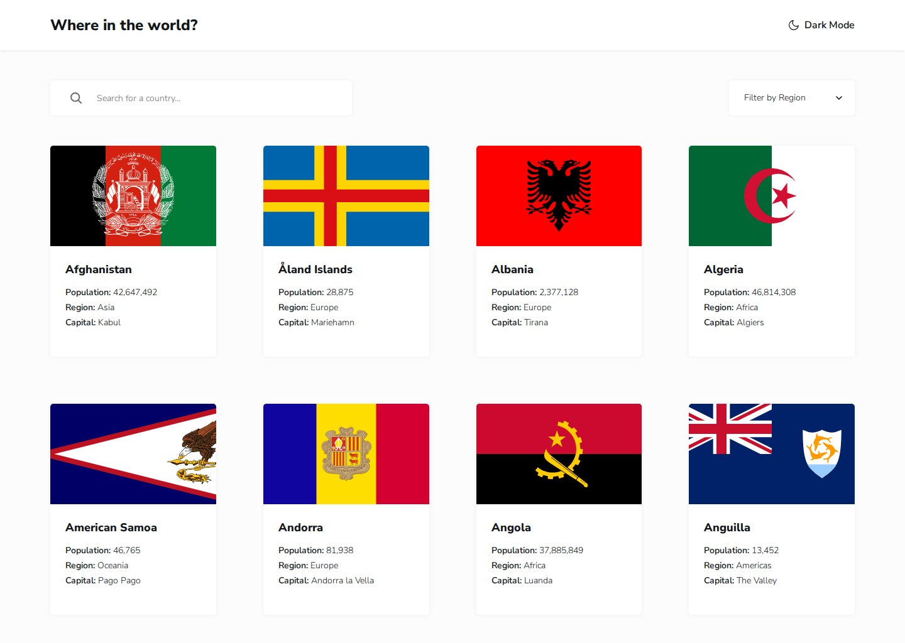

# Frontend Mentor - REST Countries API with color theme switcher solution

This is a solution to the [REST Countries API with color theme switcher challenge on Frontend Mentor](https://www.frontendmentor.io/challenges/rest-countries-api-with-color-theme-switcher-5cacc469fec04111f7b848ca). Frontend Mentor challenges help you improve your coding skills by building realistic projects.

## Table of contents

- [Overview](#overview)
  - [The challenge](#the-challenge)
  - [Screenshot](#screenshot)
  - [Links](#links)
- [My process](#my-process)
  - [Built with](#built-with)
  - [Workflow](#workflow)
  - [What I learned](#what-i-learned)
  - [Continued development](#continued-development)
  - [Useful resources](#useful-resources)
  - [AI Collaboration](#ai-collaboration)
- [Author](#author)

## Overview

### The challenge

Users should be able to:

- See all countries from the data on the homepage
- Search for a country using an `input` field
- Filter countries by region
- Click on a country to see more detailed information on a separate page
- Click through to the border countries on the detail page
- Toggle the color scheme between light and dark mode

### Screenshot



### Links

- Solution URL: [frontendmentor.io/solutions/rest-countries-api-with-tailwind-v4-hash-routing-and-apg-combobox-vn9b1fV3r1](https://www.frontendmentor.io/solutions/rest-countries-api-with-tailwind-v4-hash-routing-and-apg-combobox-vn9b1fV3r1)
- Live Site URL: [ounokoya.github.io/rest-countries-api](https://ounokoya.github.io/rest-countries-api/)

## My process

### Built with

- Semantic HTML5: landmarks, a `role="search"` form, one link per country card, description lists for the details, `<template>` elements cloned for each card
- [Tailwind CSS v4](https://tailwindcss.com/) — design tokens in `@theme`, default palette removed, colours by role (`page`, `element`, `text`…) redefined for the dark theme
- Vanilla JavaScript, one ES module per responsibility (`data.js`, `router.js`, `home.js`, `detail.js`, `region-filter.js`, `theme.js`)
- Hash routing (`#/country/BEL`, `#/?search=bel&region=Europe`): every screen has a shareable address and the browser's Back button works on GitHub Pages
- A custom region filter following the WAI-ARIA "select-only combobox" pattern
- Mobile-first layout: mobile < 768 px, tablet 768–1023 px (my proposal, no design provided), desktop ≥ 1024 px
- Nunito Sans served with the site through [Fontsource](https://fontsource.org/fonts/nunito-sans)
- [Vite](https://vite.dev/) for the build, deployed on GitHub Pages from the `gh-pages` branch (`npm run deploy`)
- [Playwright](https://playwright.dev/), [axe-core](https://github.com/dequelabs/axe-core) and the W3C Nu validator for tests

### Workflow

Before any code, the design was analysed and rebuilt:

1. **Visual analysis in Excalidraw** — every screen measured in px, font sizes fitted against the JPGs in Chromium, inventory of all interactive elements, contrast checks in both themes → [`specs/visuel/`](./specs/visuel/)
2. **Penpot mockup and prototype** — library, 36 components (light and dark, with hover and focus states), 18 screens including a tablet proposal and the states the design does not show (loading, error, no results, unknown country), click-through prototype, visual thresholds calibrated per screen → [`specs/visuel/penpot/`](./specs/visuel/penpot/)
3. **Spec, then tests** — 37 Given/When/Then scenarios and the accessible names the tests rely on → [`specs/specifications/`](./specs/specifications/); the Playwright tests were written before the code and checked to fail on the empty page
4. **Decisions** — no framework, the custom filter, font loading and flag images chosen among options → [`specs/adr/`](./specs/adr/)
5. **Code** — one commit per part (data, list, search and filter, detail and navigation, theme), then a walk-through in a real browser → [`specs/analyse/`](./specs/analyse/)

### What I learned

**The address is the state.** The screen is drawn from `location.hash` only. Typing in the search box or choosing a region rewrites the current history entry instead of adding one per letter, while opening a country adds an entry — so "Back" and the browser's back button both return to the filtered list:

```js
function update(change) {
  state = { ...state, ...change }
  history.replaceState(history.state, '', homeHash(state)) // #/?search=bel&region=Europe
  render()
}
```

**Searching without accents.** "aland" should find "Åland Islands": names and queries are compared after Unicode decomposition, without the diacritics:

```js
const normalize = (text) => text.normalize('NFD').replace(/\p{Diacritic}/gu, '').toLowerCase().trim()
```

**A custom select is more than a list.** The filter follows the APG "select-only combobox": arrows, Home, End and letters move the active option (`aria-activedescendant`), Enter, Space or Tab choose, Escape closes without changing. I first used a `<button>` and ignored clicks with `event.detail === 0` to avoid the click it fires on Enter — which also ignored the clicks screen readers send in browse mode. A focusable `<div>`, as in the APG example, avoids both problems.

**No theme flash.** A few lines in `<head>` set `data-theme` on `<html>` before the stylesheet is applied (saved choice, otherwise `prefers-color-scheme`); the colour roles change under `[data-theme="dark"]`.

**Real data is not the design.** The walk-through with the real flags found what the tests could not: flags come in many proportions (Belgium is 900 × 780), so the 264 × 160 ratio and `object-fit: cover` belong on the image itself; and `loading="lazy"` must be set before `src`, or the browser starts downloading all 250 flags at once.

### Continued development

- **Design inconsistencies.** The light detail page uses smaller text and a white background, while the dark one follows the style guide: both themes use the dark layout. The filter says "America" while the cards say "Americas": "Americas" everywhere, plus an "All regions" option so the three polar territories can be found. The theme button keeps its "Dark Mode" label (as in the design) and announces its state with `aria-pressed`.
- **Data vs. design.** The design starts with Germany and shows older populations; the page keeps the data's alphabetical order and its 2024 populations, and Belgium shows its 4 neighbours (the design shows 3). For the pixel comparisons only, the tests load a small data set that reproduces the design's content.
- **Custom select vs. native `<select>`.** Frontend Mentor's automated check suggests a native `<select>` for the region filter. I kept the custom listbox to match the design's open list, following the APG pattern and testing it with the keyboard and with clicks sent by screen readers.
- **Accessibility.** The search placeholder (Grey 400, 3.95:1) was darkened to 4.7:1; every interactive element has a 2 px focus outline; loading, result counts and errors are announced.
- **Visual comparison with the design files.** Screenshots differ from the Frontend Mentor JPGs by 1.1–3.1 % (threshold 5 %), mostly text antialiasing and the six-option region list.

### Useful resources

- [WAI-ARIA APG — Select-only combobox example](https://www.w3.org/WAI/ARIA/apg/patterns/combobox/examples/combobox-select-only/) — keyboard behaviour and roles of the region filter.
- [MDN — String.prototype.normalize()](https://developer.mozilla.org/en-US/docs/Web/JavaScript/Reference/Global_Objects/String/normalize) — accent-insensitive comparison.
- [MDN — History.replaceState()](https://developer.mozilla.org/en-US/docs/Web/API/History/replaceState) — keeping the search in the address without filling the history.
- [web.dev — Browser-level image lazy loading](https://web.dev/articles/browser-level-image-lazy-loading) — when `loading="lazy"` helps and when it does not.

### AI Collaboration

I used **Claude (Claude Code)** as a pair, inside my own spec-driven workflow where I validated each step before the next one:

- **Planning**: Claude explored the remaining challenges with me (points and levels checked on Frontend Mentor) and wrote the plan, which I validated.
- **Design analysis and mockup**: Claude measured the JPG designs, drew the annotated Excalidraw analysis and built the Penpot mockup; I reviewed both and decided how to handle the design's inconsistencies, the contrast fix, the tablet layout and the hover colours.
- **Spec and tests**: written by Claude before any code, from the validated mockup.
- **Technical decisions**: Claude presented options with their trade-offs and I chose (no framework, custom combobox, Fontsource, SVG flags).
- **Code**: written by Claude from the spec — I confirmed this split at the code lock — one commit per part, with the tests run at each step.

What worked well: tests written before the code gave a clear target, and the walk-through in a real browser caught three problems the tests could not see (flag proportions, lazy loading, screen-reader clicks), each now covered by a test. What needed my decisions: the design's inconsistencies and every choice listed above.

## Author

- Frontend Mentor - [@ounokoya](https://www.frontendmentor.io/profile/ounokoya)
- GitHub - [@ounokoya](https://github.com/ounokoya)
